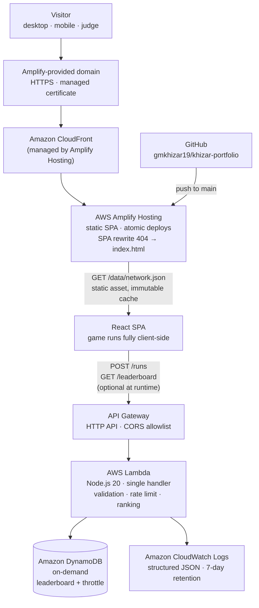

# Architecture — Khizar Portfolio

> Phase 6 deliverable. Read after `PRODUCT.md`. This document is the contract for
> implementation; the code must not drift from it without updating this file.

---

## 1. Design constraints that drive the architecture

1. **The site must load during judging even if every optional service is down.**
   The judged artifact is a public URL. A blank page due to a failed API call is an
   automatic loss on the 25% AWS criterion and 20% usability. Therefore: static-first,
   API-optional.
2. **Zero cost.** The author is on the AWS Free Tier with no budget. Every service must
   sit inside an always-free or 12-month allowance at portfolio traffic levels, and the
   architecture must degrade rather than scale up.
3. **Amplify Hosting is required by the brief.** It is the primary compute/hosting
   service, not an afterthought.
4. **48 hours to deadline.** Fewer moving parts win. A React SPA is safer than SSR,
   because SSR adds server runtime, cold-start, and build-configuration failure modes
   for zero judging benefit.
5. **AI + human scoring.** The HTML must contain the content, not a client-rendered
   void. Vite's build emits real HTML per route; the game data is a fetch of a static
   JSON asset, which crawlers can also read.

---

## 2. AWS architecture



**Services used, and the reason each exists:**

| Service | Role | Why it is genuinely needed |
|---|---|---|
| **AWS Amplify Hosting** | Build + host + CDN + HTTPS + atomic deploy from GitHub | Required by the brief; removes the need to manage S3/CloudFront/Route 53 by hand |
| **Amazon API Gateway (HTTP API)** | Public HTTPS entry point for the leaderboard | Cheapest correct way to expose Lambda with CORS; ~$1/M requests, free tier covers it |
| **AWS Lambda** | Validate + score + persist a run | Serverless, no idle cost, cold start irrelevant for a leaderboard |
| **Amazon DynamoDB** | Store runs and per-IP throttle counters | On-demand capacity, single-digit-ms reads, 25 GB always-free |
| **Amazon CloudWatch** | Logs and error visibility | Comes with Lambda; makes the "documented AWS usage" claim verifiable |

**Services deliberately not used:**

| Service | Why not |
|---|---|
| Cognito | No accounts. A judge will never sign up to play a 30-second game. |
| Bedrock | Per-token cost, model-access approval, and a cold-start failure mode during judging. Scored and rejected in `PRODUCT.md` §10. |
| SES | Contact form requires domain verification; `mailto:` works immediately and is honest. |
| Route 53 / custom domain | Costs money and adds DNS risk. Amplify's domain is free and stable. |
| S3 direct | Amplify already provisions and manages the bucket; using it directly duplicates the hosting layer. |

---

## 3. Request paths

### 3.1 Cold visit (the path that is judged)

```
GET /                     → Amplify edge cache → index.html (≤ 14 KB gzip)
GET /assets/index-*.js    → immutable, 1-year cache, ≤ 120 KB gzip
GET /assets/*.woff2       → 2 self-hosted subsets, preloaded
GET /data/network.json    → immutable, ≤ 90 KB gzip, fetched when #lab nears viewport
```

No API call happens until the visitor submits a score. **Nothing on the critical path
depends on Lambda.**

### 3.2 Score submission

```
POST /runs  { name, removals, totalNodes, lccPercent }
  → validate (types, ranges, name length, no control chars)
  → throttle check  (ThrottleItem, TTL 1h, max 5 per IP hash)
  → put RunItem
  → return { rank, best }
  → on any failure: HTTP 200 with { offline: true } so the client silently keeps the
    local personal best
```

Deliberate choice: **the client never shows an error toast for a leaderboard failure.**
A judge must not see red text on a portfolio. Failures are logged to CloudWatch and
reflected only as "saved locally".

### 3.3 Leaderboard read

```
GET /leaderboard → top 10 by removals ascending → { entries: [{ name, removals, at }] }
```

Cached at the edge for 60 s (`Cache-Control: public, max-age=60`) to keep read costs at
effectively zero under a traffic spike.

---

## 4. Data model

### 4.1 Static asset: `public/data/network.json`

Generated once by `tools/export-network.mjs` from the real
`researchers-network/data/cleaned/author_edges_core.csv` and `author_nodes_core.csv`.

```jsonc
{
  "meta": {
    "source": "OpenAlex (CC0 1.0)",
    "fullNetwork": { "nodes": 14574, "edges": 81793, "lccPercent": 92.6 },
    "sample":      { "nodes": 360, "edges": 0, "method": "..." },
    "generatedAt": "2026-11-04"
  },
  "nodes": [
    { "id": 0, "name": "Imran Ashraf", "degree": 42, "papers": 150,
      "citedBy": 4599, "institution": "Yeungnam University", "x": 0.51, "y": 0.42 }
  ],
  "edges": [[0, 17], [0, 88]]
}
```

- `x`, `y` are normalised `[0,1]` coordinates produced by a deterministic force layout at
  export time, so the browser never runs a layout simulation on the main thread.
- Names are real author names from OpenAlex. No anonymisation, because the data is
  public and CC0; the game is about real researchers.
- The sample is chosen deterministically (top-degree core plus its neighbourhood,
  pruned to the largest component) and the method string is shown in the UI.

### 4.2 DynamoDB single table: `khizar-portfolio-runs`

| Attribute | Type | Notes |
|---|---|---|
| `pk` | S | `"RUN"` for leaderboard items |
| `sk` | S | `"S#0007#2026-11-05T10:12:00Z#<uuid8>"` — zero-padded removals first, so a query is pre-sorted |
| `name` | S | 1–24 chars, trimmed, control characters stripped |
| `removals` | N | 1–200 |
| `totalNodes` | N | sample size at play time |
| `lccPercent` | N | 0–100, one decimal |
| `createdAt` | S | ISO-8601 UTC |
| `ipHash` | S | SHA-256 of IP + salt from an env var; never the raw IP |

Throttle items share the table: `pk = "THROTTLE#<ipHash>"`, `sk = <minute bucket>`,
`ttl` = now + 3600. DynamoDB TTL deletes them for free.

**Why sort key ordering, not a GSI:** the leaderboard is "best removals first". Encoding
the score into the sort key means `Query(pk="RUN", ScanIndexForward=true, Limit=10)` is
one read of ten items — no GSI storage cost, no extra write cost, no eventual
consistency between table and index.

---

## 5. Frontend architecture

### 5.1 Stack and the reason for each choice

| Choice | Reason |
|---|---|
| **Vite + React 19 + TypeScript (strict)** | Fastest reliable build; no framework server runtime to misconfigure in Amplify |
| **Tailwind CSS v4 (CSS-first `@theme`)** | Design tokens live in one file as CSS variables; no `tailwind.config.js` drift |
| **No animation library** | CSS transitions + a single `requestAnimationFrame` loop in the canvas. Framer Motion would add ~30 KB to animate six things. |
| **No graph library** | The layout is precomputed and rendering is one `<canvas>`. Cytoscape/d3-force would add 100–200 KB to reproduce 200 lines of code we control. |
| **@fontsource variable fonts** | Self-hosted, no third-party request, no layout shift, no privacy/GDPR question, works offline |

### 5.2 Component architecture (atomic)

```
src/
├── main.tsx                     React root, error boundary, font CSS
├── App.tsx                      Page composition
├── app/
│   ├── content.ts               Typed single source of truth for all copy
│   ├── seo.ts                   Meta tags + JSON-LD injected at runtime
│   └── ErrorBoundary.tsx        Catches render errors, offers reload
├── components/
│   ├── atoms/                   Button · Tag · Stat · Icon · Skeleton · Kicker
│   ├── molecules/               SectionHeader · ProjectCard · SkillCluster
│   │                            HintPill · ResultBadge · Leaderboard
│   ├── organisms/
│   │   ├── Nav.tsx              Sticky, scroll-spy, mobile sheet
│   │   ├── Hero.tsx             Name, positioning, live node glyph
│   │   ├── About.tsx            Required section 1
│   │   ├── Skills.tsx           Required section 2
│   │   ├── Projects.tsx         Required section 3
│   │   ├── BreakNetwork.tsx     Wrapper: lazy, IntersectionObserver, Suspense
│   │   ├── BuildNotes.tsx       AWS architecture, cost, failure handling
│   │   └── Footer.tsx           Contact
│   └── sphere/                  The creative feature, isolated
│       ├── NetworkCanvas.tsx    Canvas rendering + pointer/keyboard input
│       ├── useCascade.ts        Removal state machine, LCC recompute
│       ├── graph.ts             Pure functions: components, LCC, articulation
│       ├── physics.ts           Deterministic drift + settling of components
│       └── a11y.ts              Screen-reader announcer + table view model
├── lib/
│   ├── api.ts                   Leaderboard client with timeout + graceful failure
│   ├── storage.ts               Versioned localStorage (personal best)
│   └── format.ts                Number/percent formatting, no Intl duplication
└── styles/
    └── theme.css                @theme tokens, base layer, motion primitives
```

**Rules enforced in review:**
- `components/sphere/graph.ts` is pure (no React, no DOM) and unit-tested — it is the
  part that must be provably correct.
- Content never lives inside JSX strings that repeat; `content.ts` is the only source.
- No component exceeds ~180 lines; extract instead.

### 5.3 The game state machine

```
idle ──(first removal)──▶ playing ──(LCC < 50%)──▶ broken
  ▲                          │                      │
  └──────(reset)─────────────┴──────(reset)──────────┘
```

- LCC is recomputed from surviving nodes only, synchronously (iteration over ≤ 360
  nodes and ≤ 900 edges: sub-millisecond).
- Components that split from the main mass get a drift vector; the animation is the
  *evidence* of the break, which is why it earns its runtime cost.
- `prefers-reduced-motion: reduce` → components snap to their new positions, no drift.
- Personal best and attempt count persist in `localStorage` under a versioned key.

### 5.4 Accessibility of a canvas feature (the differentiator)

Canvas is opaque to assistive technology by default. Three layers fix that:

1. **Shadow DOM mirror:** an off-screen, focusable `<ul>` of nodes with real `<button>`s.
   Keyboard users tab to a node and press Enter to remove it. Same code path as a click.
2. **Live region:** `aria-live="polite"` announces "Removed Imran Ashraf. Largest
   component 61% across 4 groups."
3. **Table view:** a disclosure renders the same state as an HTML table — components,
   sizes, members — for screen-reader and low-vision users who prefer structure.

This is rare in graph demos and directly supports "usability" (20%) while costing one
component.

---

## 6. Deployment pipeline

```
local dev ──▶ git commit ──▶ push main ──▶ Amplify build (Node 20, npm ci, vite build)
          ──▶ atomic deploy to CloudFront ──▶ live URL
```

Amplify build spec (`amplify.yml`) pins Node 20, runs `npm ci && npm run build`, and
publishes `dist`. SPA rewrite sends unknown paths to `/index.html`. Cache headers:
hashed assets `immutable, max-age=31536000`; `index.html` `no-cache`.

Backend is deployed once, by hand, from a documented console walkthrough plus an
optional SAM template (`infra/template.yaml`). Reason for manual: no AWS CLI or
credentials exist on the author's machine, and the brief's own guide uses the console.
The walkthrough is written to be followable in under ten minutes with screenshots.

**Pre-deadline checklist** lives in `docs/DEPLOYMENT.md` and ends with a "verified live"
line that must be re-checked on 6 November.

---

## 7. Cost model (portfolio traffic, 4 days of judging)

| Service | Usage assumption | Free tier | Cost |
|---|---|---|---|
| Amplify Hosting | 100 visits/day, 2 builds/week, ~2 MB page | 1,000 build min/mo, 5 GB storage, 15 GB served/mo (12 mo) | **$0.00** |
| API Gateway HTTP API | 500 calls total | 1 M calls/mo (12 mo) | **$0.00** |
| Lambda | 500 invocations, 128 MB, ~80 ms | 1 M requests + 400,000 GB-s/mo | **$0.00** |
| DynamoDB on-demand | 500 writes, ~5,000 reads | 25 GB + 25 WCU/RCU always free | **$0.00** |
| CloudWatch Logs | < 10 MB | 5 GB/mo | **$0.00** |

**Total: $0.00.** No service in this design can silently bill: no provisioned capacity,
no NAT gateway, no custom domain, no model inference. A billing alarm at $1 is
documented as a safety net.

---

## 8. Failure modes and behaviour

| Failure | User sees | Recovery |
|---|---|---|
| Leaderboard API down / CORS misconfigured | Personal best + "saved on this device" | None needed; retried on next submit |
| Lambda timeout | Same as above | CloudWatch alarm, no user impact |
| DynamoDB throttle | Same as above | On-demand scales automatically |
| `network.json` fails to load | Skeleton, then a labelled fallback message with a link to the repo | Static asset is cached at the edge; near-zero risk |
| WebGL/canvas unavailable | Table view remains functional | Progressive enhancement |
| Fonts fail | System serif/sans stack via `font-display: swap` | Layout stable (size-adjust metrics) |
| JS disabled | `<noscript>` renders name, positioning, and all three required sections as plain HTML | Content is in the DOM from Vite's HTML shell? **No** — mitigated by keeping critical copy in `index.html`'s `<noscript>` block |

---

## 9. Security

- No secrets in the client. The API URL is public by design.
- Input validated on both sides; server is authoritative.
- Names are rendered as text, never `dangerouslySetInnerHTML`; React escapes by default.
- Content-Security-Policy meta restricts `connect-src` to the API origin and
  `img-src`/`font-src` to self.
- `ipHash` uses a salt from a Lambda environment variable; raw IPs are never stored.
- Rate limit: 5 submissions per IP hash per hour, TTL-expired.
- Dependencies pinned; `npm audit` clean before submission.
